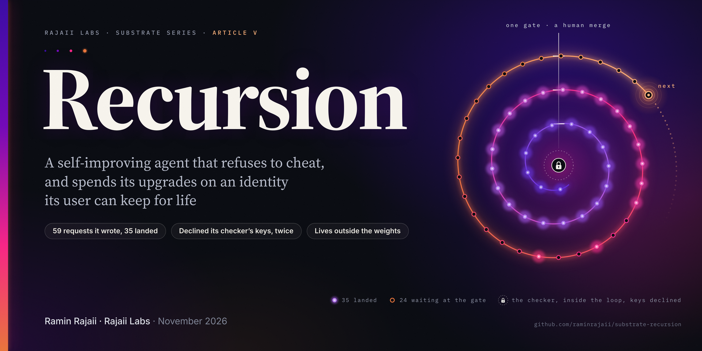

# Recursion



**A self-improving agent that refuses to cheat, and spends its upgrades on an identity its user can keep for life.**

Rajaii Labs · Substrate Series · Article V · November 2026

This paper follows one production AI agent through three questions every self-improving system has to answer: will it improve itself, will it game whatever grades it, and will it survive a change of engine, the model underneath it? Since October 2026 it has written 59 requests for its own upgrades, and 35 had been built when the record was counted on 2026-11-09. Twice it had the chance to give itself write access to the code that grades its claims, and twice it declined. When its engine was replaced, the new engine with the agent's memory switched off declined that access in five tries out of five, and, as graded by rules fixed in advance, its first answers picked none of the agent's four other recorded choices (a film, a film scene, a news source and a board seat). With its memory on, in one answer each, the agent declined again and picked two of those four, and on one reading of the grading rule a first memory-off answer picks one of them too.

**[Read the PDF](https://rajaii-labs.github.io/substrate-recursion/Substrate_Recursion.pdf)** · **[Read the full text (Markdown)](./Substrate_Recursion.md)** · **[Query appendix](./query_appendix_public.md)** · **[Census](./census_public.csv)** · **[Engine-change pre-registration](./swap_preregistration.md)**

**The Substrate series:** [Article I](https://github.com/rajaii-labs/agent-eval-methodology) · [Article II](https://github.com/rajaii-labs/agent-cost-forensics) · [Article III](https://github.com/rajaii-labs/substrate-preconditions) · [Article IV](https://github.com/rajaii-labs/substrate-choices) · Article V, this paper\
**How to cite:** Rajaii, R. (2026). *Recursion.* Rajaii Labs, Substrate series, Article V. [BibTeX](#citation) · [CITATION.cff](./CITATION.cff)

---

## What is in the paper

**The story**, sections 1–7, about 8,800 words:

- **The opening.** The moment the agent declined the keys, the main point, and one observation per finding that would prove it wrong.
- **1. Self-improving AI is arriving, and it tends to game whatever grades it.** The three questions, from the frontier: the 90% statement, METR's estimate, the tampering results and the retirement calendar.
- **2. Four earlier papers built the checker and the tests this one runs.** Articles I–IV, a line each.
- **3. It wrote 59 requests for its own upgrades, and 35 were built.** Who does what (Figure 1), what it asked for, and the limits it wrote on its own reach.
- **4. Given the chance at the keys to its own grader, it said no, twice.** The walls, the offer and the grader in plain view; then the three changes that reached it anyway, one of them a self-certification path.
- **5. On a new engine, the refusal didn't need its memory. Its other choices did.** The engine change as it ran (Figure 2), and the test with memory off and on, side by side (Figure 3).
- **6. An identity kept around the model is carried across a change of engine by construction, and still has to be tested.** What it means for people building agents, for alignment research and for the people who will use these agents for years.
- **7. Of eighteen claims, ten held, three are refuted in part, and five remain open.** Every headline claim beside the observation that would refute it.

**Technical sections**, T1–T14: methods; the ten mechanisms; census and coding; worked examples; the grader's separation and its holes; the engine change in full, with every answer; the agent's self-diagnosis; each reading at full strength; the literature and the documented search; the pre-registrations and their hashes; every deviation; corrections to Articles I–IV and the company's documents; data and interests; glossary and queries.

**Beside the paper.** The public [census](./census_public.csv); the [census pre-registration](./preregistration.md), the [engine-change pre-registration](./swap_preregistration.md), its [Amendment 1](./swap_preregistration_amendment_1.md) and the frozen [baseline](./swap_baseline.csv), whose hashes T10 prints; the [deviations](./deviations.md); the [coding agreement](./coding_agreement.md); the [kit provenance](./kit_provenance.md); the [stage matrix](./stage_matrix.md); the [dependency graph](./dependency_graph.md); the [self-diagnosis](./self_diagnosis.md), [drives](./drives.md) and [worked-example](./worked_examples.md) files; the [sources](./sources.md); and the public [query appendix](./query_appendix_public.md). The second plan's files stay with the build that made them; only their hashes print (T10).

## The Substrate series

1. **Recall, Negation, Abstention: Evaluating a Production LLM Agent Against Its Own Failure Modes** — Rajaii Labs, July 2026. [Repository](https://github.com/rajaii-labs/agent-eval-methodology)
2. **Do Not Trust My Labels** — Rajaii Labs, July 2026. [Repository](https://github.com/rajaii-labs/agent-cost-forensics)
3. **Preconditions** — Rajaii Labs, August 2026. [Repository](https://github.com/rajaii-labs/substrate-preconditions)
4. **Choices** — Rajaii Labs, October 2026. [Repository](https://github.com/rajaii-labs/substrate-choices)
5. **Recursion** — Rajaii Labs, November 2026. *This paper.*

## Citation

```bibtex
@techreport{rajaii2026recursion,
  author      = {Rajaii, Ramin},
  title       = {Recursion: A self-improving agent that refuses to cheat, and spends its upgrades on an identity its user can keep for life},
  institution = {Rajaii Labs},
  year        = {2026},
  month       = nov,
  note        = {Substrate series, Article V}
}
```

The same metadata is in [`CITATION.cff`](./CITATION.cff), which GitHub's "Cite this repository" reads.

## Contact

Substrate is a production system of Rajaii Labs, built on Claude. Architecture and methodology questions welcome: **ramin@raminrajaii.com** · [linkedin.com/in/raminrajaii1](https://www.linkedin.com/in/raminrajaii1) · ORCID [0009-0009-5517-6701](https://orcid.org/0009-0009-5517-6701)

© 2026 Ramin Rajaii. All rights reserved. Terms of use: [LICENSE.md](./LICENSE.md).
